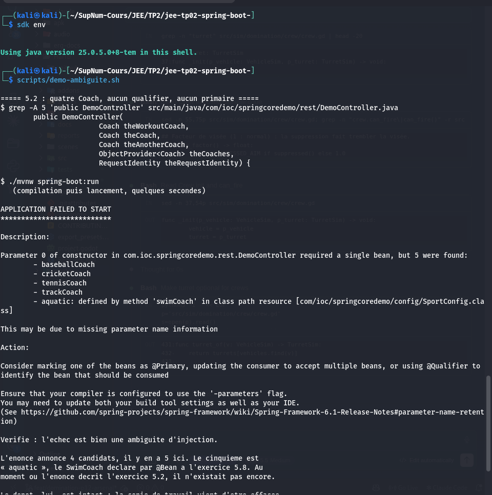
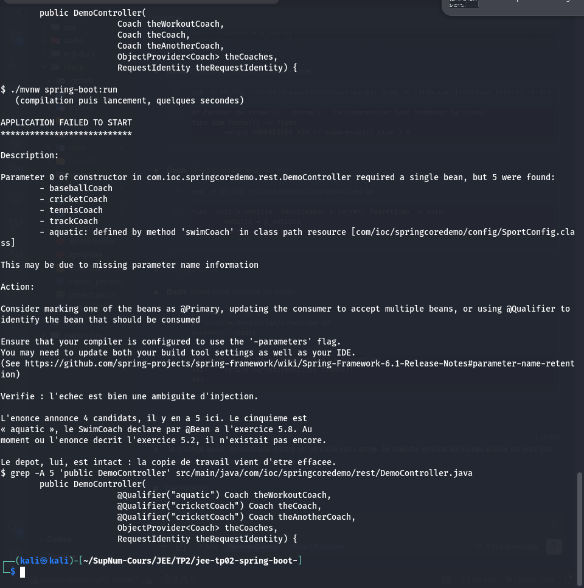
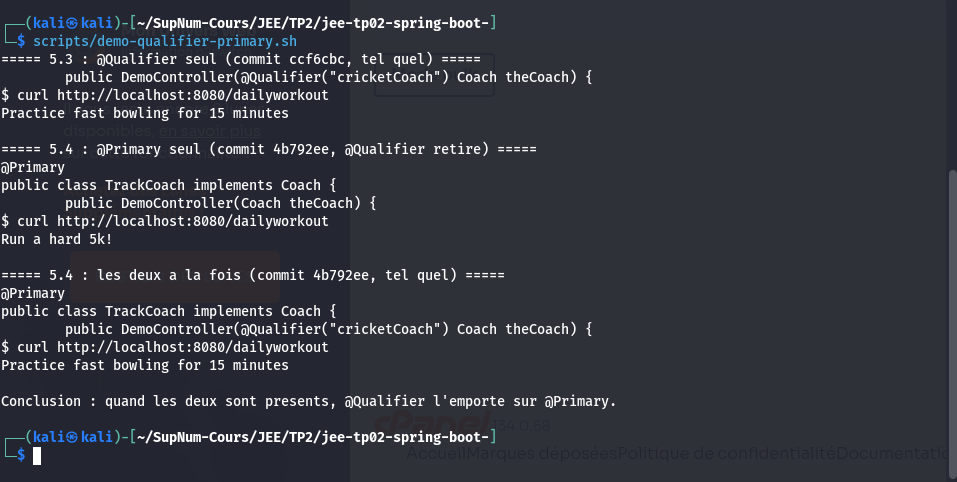
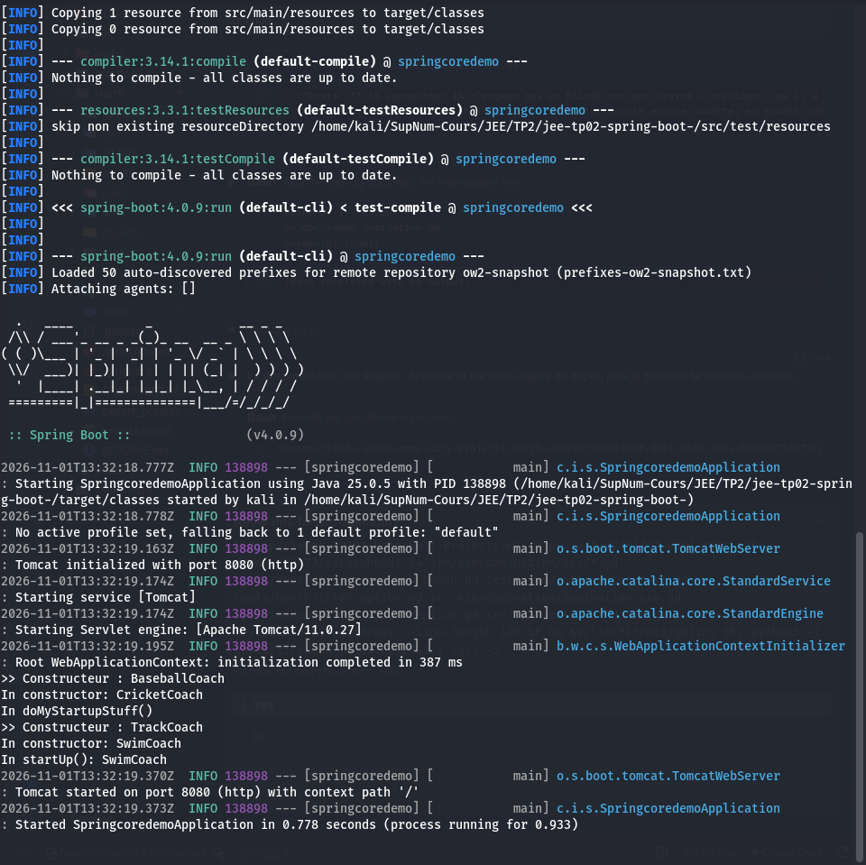
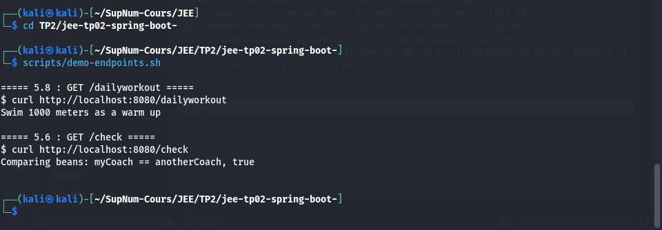
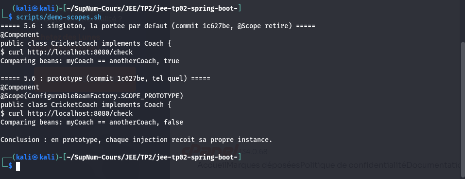
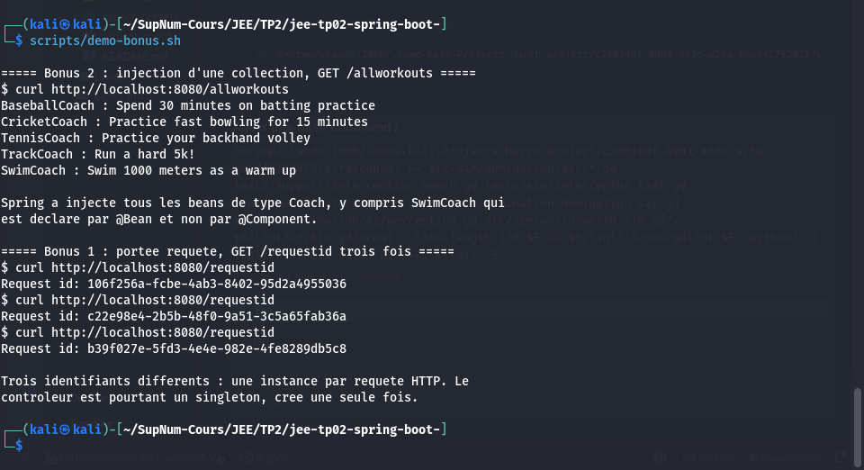
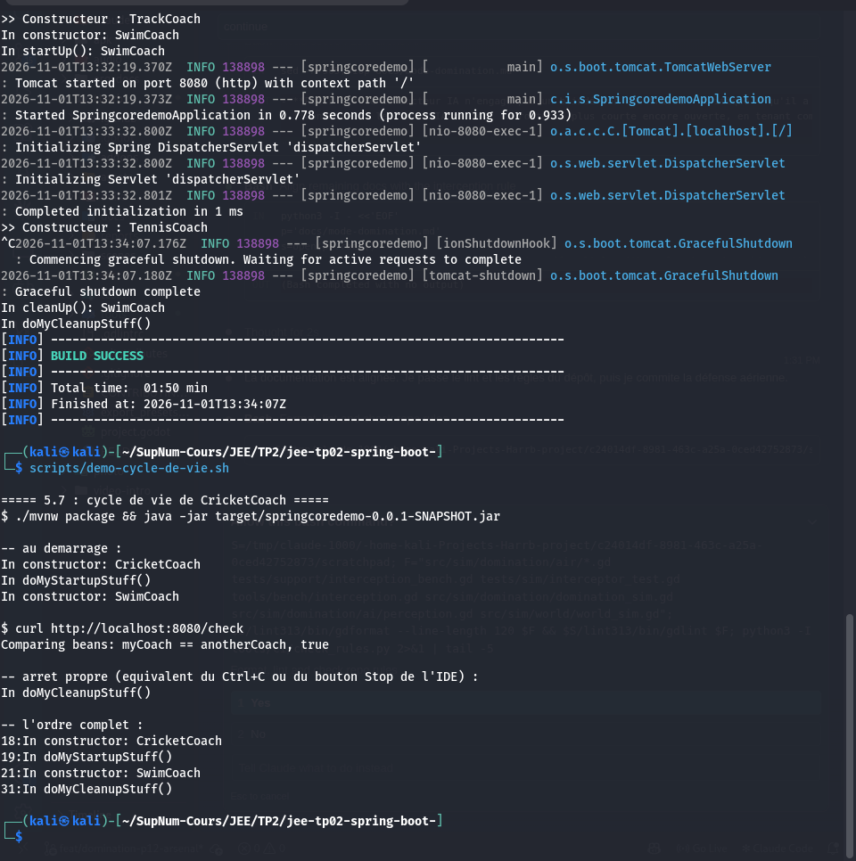

# springcoredemo

[](https://github.com/LeminEly/jee-tp02-spring-boot-/actions/workflows/ci.yml)

TP 02 du module JEE : inversion de controle et injection de dependances avec
Spring Core.

L'application n'a aucune logique metier. Son seul objet est de rendre le
conteneur Spring **observable** : quelle implementation il injecte, s'il partage
une instance ou en cree plusieurs, et dans quel ordre il appelle le cycle de vie
d'un bean.

## Prerequis

- JDK 25. La version exacte est figee dans `.sdkmanrc`. Dans le depot :
  `sdk env`, puis verifier que `javac -version` affiche bien 25. Un JRE suffit a
  lancer l'application, pas a la compiler.
- Rien d'autre. Maven est fourni par le wrapper `./mvnw`, et le serveur est
  embarque dans l'archive.

## Lancer

Trois facons, au choix.

```sh
# 1. depuis l'IDE : executer la methode main de SpringcoredemoApplication

# 2. par le plugin Maven
./mvnw spring-boot:run        # ou : scripts/run.sh

# 3. par l'archive
./mvnw package
java -jar target/springcoredemo-0.0.1-SNAPSHOT.jar
```

L'application ecoute sur le port 8080.

## Points d'acces

| Methode | Chemin | Reponse | Exercice |
| --- | --- | --- | --- |
| GET | `/dailyworkout` | `Swim 1000 meters as a warm up` | 5.1, puis 5.8 |
| GET | `/check` | `Comparing beans: myCoach == anotherCoach, true` | 5.6 |
| GET | `/allworkouts` | Les cinq coachs et leur seance | bonus 2 |
| GET | `/requestid` | Un identifiant different a chaque appel | bonus 1 |

Aucune authentification : contrairement au TP 01, aucun starter de securite
n'est declare. C'est voulu, et explique dans `SECURITY.md`.

## Les beans de ce projet

| Bean | Classe | Declare par | Particularite |
| --- | --- | --- | --- |
| `cricketCoach` | `CricketCoach` | `@Component` | Singleton, porte `@PostConstruct` et `@PreDestroy` |
| `baseballCoach` | `BaseballCoach` | `@Component` | |
| `tennisCoach` | `TennisCoach` | `@Component` | `@Lazy` : absent du demarrage |
| `trackCoach` | `TrackCoach` | `@Component` | `@Primary` : choisi par defaut |
| `aquatic` | `SwimCoach` | `@Bean` dans `SportConfig` | Classe sans annotation, identifiant explicite, `initMethod` et `destroyMethod` |
| `requestIdentity` | `RequestIdentity` | `@Component` | Portee requete, servi par un mandataire |

`DemoController` recoit trois parametres : le coach `aquatic` pour
`/dailyworkout`, et deux fois `cricketCoach` pour que `/check` compare deux
references. C'est la superposition des exercices 5.6 et 5.8, expliquee dans
`REPONSES.md`.

## Etat de l'etat final, et ce qui vit dans l'historique

Certains exercices se contredisent : le depot ne peut porter qu'un etat a la
fois. Ce qui ne survit pas dans le code final reste lisible ailleurs.

| Observation | Ou la retrouver |
| --- | --- |
| `NoUniqueBeanDefinitionException` de 5.2 | `CoachAmbiguityTest`, et `scripts/demo-ambiguite.sh` |
| `@Primary` seul, puis la priorite du qualifier | `PrimaryVersusQualifierTest`, commit `feat(5.4)`, `scripts/demo-qualifier-primary.sh` |
| Deux `@Primary`, le piege | `PrimaryVersusQualifierTest` |
| `spring.main.lazy-initialization=true` | commit `feat(5.5)`, retire au commit suivant |
| `/check` a `false` en portee prototype | `BeanScopeTest`, commit `feat(5.6)`, `scripts/demo-scopes.sh` |
| `@PreDestroy` ignore sur un prototype | `REPONSES.md`, question 7 |

## Tests

```sh
./mvnw test
```

Dix tests. Le `contextLoads` genere, plus quatre classes qui figent ce que les
exercices demandent d'observer. Ces tests sont inhabituels pour un TP : ils
existent parce que plusieurs observations ne peuvent pas coexister dans le code
livre, et qu'un test les rend rejouables la ou une capture n'est qu'un
instantane.

## Qualite et integration continue

| Porte | Ou | Ce qu'elle refuse |
| --- | --- | --- |
| `pre-commit` | local et CI | Espaces en fin de ligne, YAML, JSON, TOML et XML invalides, fichiers de plus de 512 Ko, cles privees |
| `gitleaks` | local et CI | Secrets, et sur **tout** l'historique en CI |
| Message de commit | local | Tout message hors convention |
| `./mvnw test` | local et CI | Code qui ne compile pas, test rouge, mauvais JDK |
| Demarrage de l'archive | CI | Une application qui compile mais refuse de demarrer |

Chacune a ete soumise a un cas fautif et vue refuser. La distribution Maven est
verrouillee par empreinte, et les actions GitHub sont epinglees par empreinte de
commit.

Installer les controles apres un clone :

```sh
pre-commit install && pre-commit install --hook-type commit-msg
```

## Captures d'ecran

Les images sont affichees ici, et les fichiers vivent dans `screenshots/`.
Chacune a ete prise en lancant le script indique sous son titre.

### 5.2 : l'ambiguite provoquee

`scripts/demo-ambiguite.sh`



Le message annonce **5 candidats** la ou l'enonce en annonce 4. Le cinquieme est
`aquatic`, le `SwimCoach` declare par `@Bean` a l'exercice 5.8, qui n'existait
pas au moment ou l'enonce decrit l'exercice 5.2.

Le script travaille sur une copie temporaire des sources. La fin de son
execution le montre : le depot a retrouve ses `@Qualifier`.



### 5.3 et 5.4 : `@Qualifier`, `@Primary`, puis les deux

`scripts/demo-qualifier-primary.sh`



L'etat final qualifie le coach `aquatic` : ces trois reponses n'y existent plus.
Le script les rejoue depuis les commits des exercices 5.3 et 5.4, extraits dans
un dossier temporaire. Le dernier cas tranche : quand les deux annotations sont
presentes, `@Qualifier` l'emporte.

### 5.5 : les beans crees au demarrage

`scripts/run.sh`



Quatre constructeurs s'affichent. `TennisCoach` n'y est pas : il porte `@Lazy` et
personne ne le demande encore.

### 5.8 et 5.6 : les deux points d'acces

`scripts/demo-endpoints.sh`



### 5.6 : `/check` en singleton, puis en prototype

`scripts/demo-scopes.sh`



L'etat final remet `CricketCoach` en singleton pour l'exercice 5.7. Le `false`
est rejoue depuis le commit de l'exercice 5.6, dans un dossier temporaire.

### Bonus 1 et 2 : collection injectee et portee requete

`scripts/demo-bonus.sh`



### 5.7 : le cycle de vie d'un bean singleton

`scripts/demo-cycle-de-vie.sh`



### Reprendre les captures

Ordre, qui n'est pas indifferent :

1. `scripts/demo-ambiguite.sh`, aucune application n'ayant besoin de tourner et
   le port 8080 devant etre libre.
2. `scripts/demo-qualifier-primary.sh`, puis `scripts/demo-scopes.sh`, le port
   8080 devant toujours etre libre. Chacun s'arrete en erreur, sans rien
   afficher de trompeur, si une reponse n'est pas celle attendue.
3. `scripts/run.sh` dans un premier terminal, et capturer **tout de suite** le
   demarrage. Cette capture se prend **avant** l'etape 5 : l'appel a
   `/allworkouts` construit `TennisCoach` et ferait disparaitre ce qu'elle doit
   montrer.
4. `scripts/demo-endpoints.sh` dans un second terminal.
5. `scripts/demo-bonus.sh` dans ce meme second terminal.
6. Arreter l'application, puis `scripts/demo-cycle-de-vie.sh`, qui gere lui-meme
   son demarrage et son arret.

Avant de capturer : opacite du terminal a 100 % et autres fenetres fermees, pour
qu'aucun contenu etranger ne transparaisse.

## Extensions de la section 9

Les trois bonus de l'enonce sont faits, dans un commit separe pour que le
livrable de base reste identifiable.

| Bonus | Ou |
| --- | --- |
| Portee `request` avec mandataire | `RequestIdentity`, point d'acces `/requestid` |
| Injection d'une collection | `/allworkouts` |
| `@Bean(initMethod, destroyMethod)` | `SportConfig` et `SwimCoach` |

Le second a demande une decision. Injecter `List<Coach>` au constructeur, comme
l'enonce le suggere, construit **tous** les coachs au demarrage, `TennisCoach`
compris, ce qui annule le `@Lazy` de l'exercice 5.5. Mesure faite dans les deux
sens. Le controleur recoit donc un `ObjectProvider<Coach>`, qui resout la
collection au premier appel. Detail dans `REPONSES.md`.

## Reponses aux questions

Voir `REPONSES.md` : les huit questions de la section 6 de l'enonce, le tableau
des scopes complete, les mesures de chaque experience demandee, et trois ecarts
assumes par rapport a l'enonce avec leur raison.
